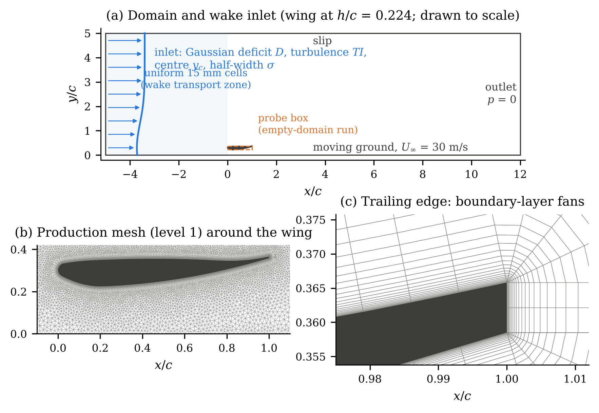
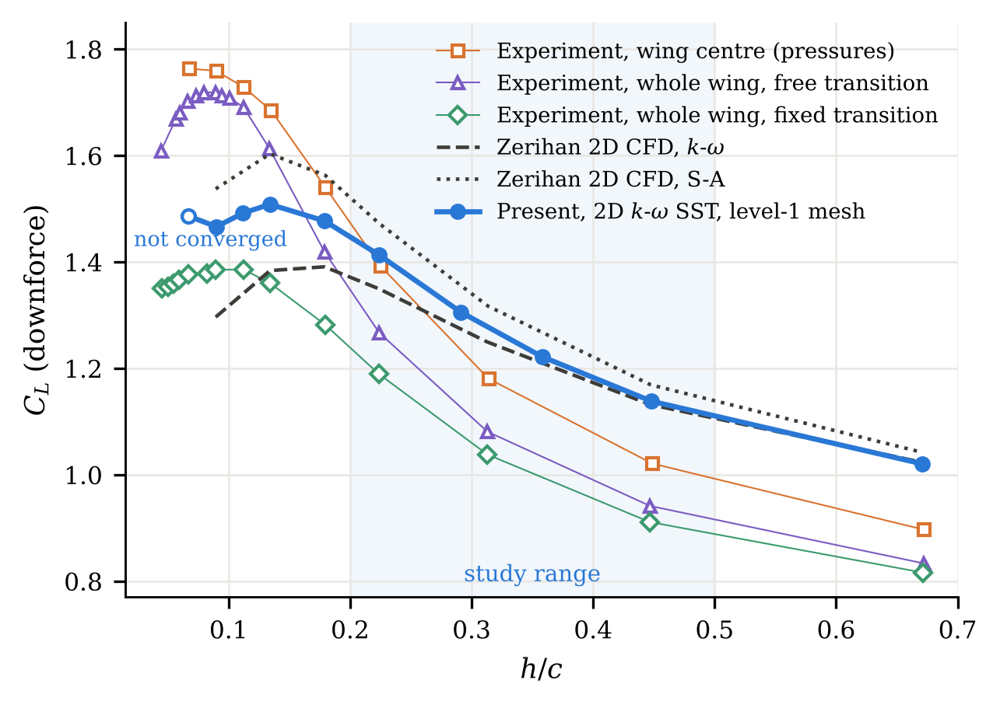
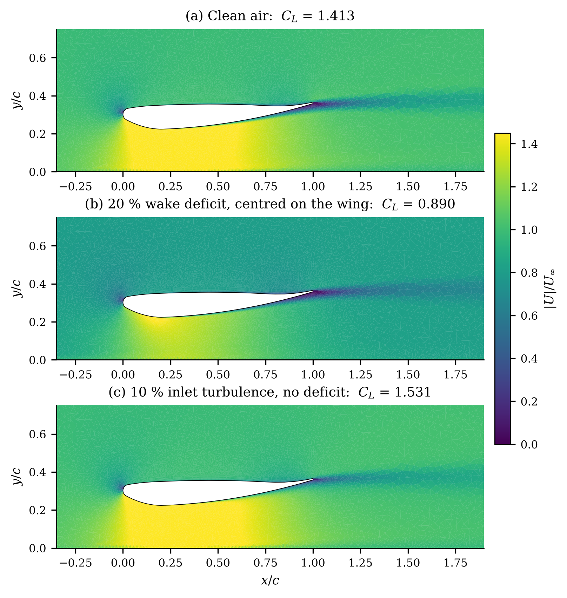
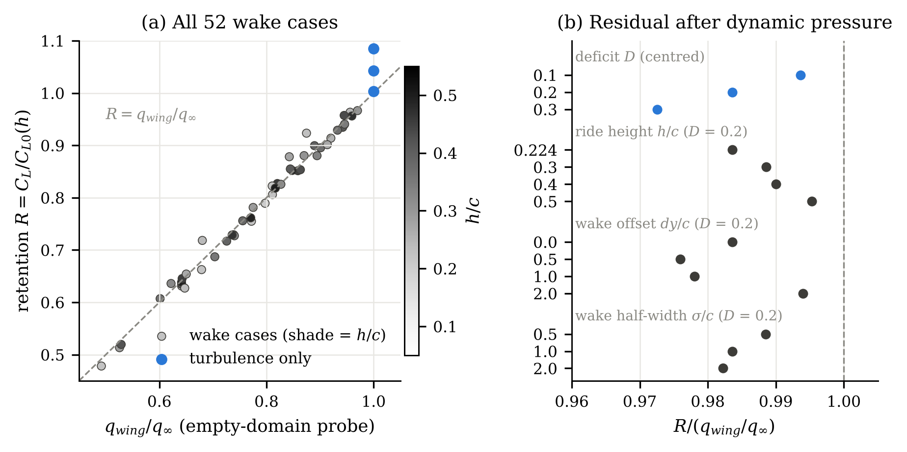
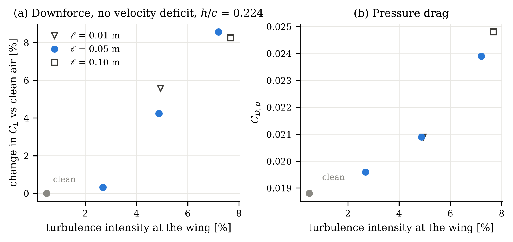
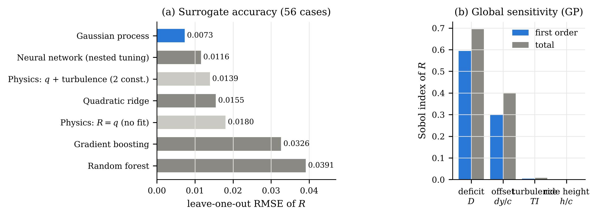

# Ground-effect wing in a wake: validated 2D CFD and surrogate models

[](https://doi.org/10.5281/zenodo.24552176)
[](LICENSE)

Code, simulation set-up and results for the preprint

> **B. Mehmood (2026).** *Downforce loss of a ground-effect wing in a wake is a dynamic-pressure effect: validated
> 2D CFD and a comparison of surrogate models.* Zenodo. [doi:10.5281/zenodo.24552176](https://doi.org/10.5281/zenodo.24552176)

**In one sentence:** a racing-car wing running close to the ground, in the wake of another car, keeps its clean-air
lift coefficient based on the dynamic pressure it actually meets. So the slower air explains **97 %** of the downforce
loss, ride height barely matters, and a Gaussian-process surrogate reproduces the CFD to **0.007** in retention.

Everything below ran on a 4-core laptop (Windows + WSL, OpenFOAM in Docker).

---

## Contents
1. [The question](#1-the-question)
2. [Step 1: wing, domain and mesh](#step-1-wing-domain-and-mesh)
3. [Step 2: solver set-up](#step-2-solver-set-up)
4. [Step 3: verification (is the mesh good enough?)](#step-3-verification-is-the-mesh-good-enough)
5. [Step 4: validation against the wind tunnel](#step-4-validation-against-the-wind-tunnel)
6. [Step 5: putting the wing in a wake](#step-5-putting-the-wing-in-a-wake)
7. [Step 6: the 56-case campaign and the main result](#step-6-the-56-case-campaign-and-the-main-result)
8. [Step 7: turbulence in the wake](#step-7-turbulence-in-the-wake)
9. [Step 8: surrogate models and sensitivity](#step-8-surrogate-models-and-sensitivity)
10. [Limitations](#limitations)
11. [Reproducing everything](#reproducing-everything)
12. [Repository layout](#repository-layout)

---

## 1. The question

A car that follows another closely loses downforce in the leading car's wake ("dirty air"), which is the main
aerodynamic barrier to overtaking in Formula 1. Wind-tunnel and CFD studies show *that* a following wing loses
downforce, but each covers only a few wake settings, so it is unclear **which features of the wake cause the loss**:

- the velocity deficit (slower air);
- the extra turbulence;
- the wake's height and width;
- the wing's own ride height.

This project separates those effects with a validated, laptop-scale CFD model, then tests whether cheap surrogate
models can replace the simulations.

---

## Step 1: wing, domain and mesh

**Wing.** The single-element front wing tested by Zerihan (2001) at the University of Southampton. It is derived
from the Tyrrell 026 Formula 1 car: chord c = 223.4 mm, reference incidence 1°, blunt trailing edge. It was chosen
because it has published forces, surface pressures and CFD to validate against.

**Domain.** The domain is two-dimensional and one cell thick:

- **Extent:** 5c upstream, 12c downstream, 5c above the ground.
- **Ground:** moves at the freestream speed, as a rolling road does in the wind tunnel.
- **Ride height:** h is measured from the ground to the lowest point of the wing.

**Mesh.** gmsh builds hybrid meshes:

- **Near the wall:** structured layers on the wing, first cell 15 µm thick (y⁺ ≈ 1), growth ratio 1.2.
- **Trailing edge:** boundary-layer "fans" at both corners of the blunt edge.
- **Elsewhere:** triangles, refined around the wing, its wake and the ground.
- **Wake cases only:** an extra zone of uniform 15 mm cells carries the imposed wake from the inlet to the wing without numerical smearing.



*Figure 1: (a) domain, wake inlet and probe box, to scale; (b) production mesh around the wing; (c) boundary-layer
fans at the blunt trailing edge.*

> **A bug worth knowing about.** The first meshes used gmsh's `PointsList` at the trailing edge, which *ends* the
> boundary layer at the corner instead of fanning it round. Cells there were badly distorted (non-orthogonality up to
> about 85–90°), the fine meshes crashed, and lift was inflated by up to 15 %. Switching to `FanPointsList`
> (`cfd2d/mesh.py`) fixed all three. Every result here uses the corrected mesh.

Code: `cfd2d/mesh.py`.

---

## Step 2: solver set-up

| Item | Choice | Why |
|---|---|---|
| Equations | Steady incompressible RANS (`simpleFoam`, OpenFOAM v2512) | Attached flow in the studied range; affordable for 60+ cases |
| Turbulence model | k-ω SST | Standard, well-validated model for wings in adverse pressure gradients |
| Speed, Reynolds number | 30 m/s, Re = 4.5 × 10⁵ | As in the wind-tunnel tests |
| Convection schemes | linearUpwind (U), limitedLinear (k, ω) | Second-order and bounded |
| Convergence rule | C_L changes < 0.5 % over the last 500 iterations | Checks the quantity of interest, not only residuals |
| Forces | Integrated wall pressure | Drag here means pressure drag; downforce is reported as positive C_L |

Code: `cfd2d/make_case.py` (writes the OpenFOAM case), `cfd2d/run_case.sh` (mesh → case → solve → forces),
`cfd2d/forces.py`. `foam.sh` runs OpenFOAM natively or in Docker.

---

## Step 3: verification (is the mesh good enough?)

Three meshes, each about 1.4 times finer than the last, were compared using the Grid Convergence Index
(Celik et al. 2008). Each finer mesh started from the coarser solution, and every run converged.

| h/c | Cells (k): L1 / L2 / L3 | C_L: L1 / L2 / L3 | Result |
|---|---|---|---|
| 0.448 | 44.6 / 79.8 / 154.3 | 1.1384 / 1.1345 / 1.1324 | Observed order p = 2.41, extrapolated C_L = 1.1307, **GCI_fine = 0.19 %** |
| 0.224 | 40.8 / 72.6 / 137.6 | 1.4134 / 1.4181 / 1.4097 | Oscillatory convergence, spread **0.6 %** |

**Level 1 (about 41–45k cells) is the production mesh.** It is within 0.7 % of the mesh-converged value, so the
numerical uncertainty is below 1 %.

Code and data: `validation/run_mesh_study.sh`, `validation/gci.py`, `results/results_mesh_study.csv`.

---

## Step 4: validation against the wind tunnel

Clean-air downforce was computed at ten ride heights and compared with Zerihan's measurements and his own
published 2D CFD.



*Figure 2: clean-air downforce against ride height. Experimental and reference values were digitised from the
thesis scan, to ±0.003 in C_L.*

| h/c | C_L (this work) | vs Zerihan 2D k-ω | vs Zerihan 2D S-A | vs experiment (wing centre) |
|---|---|---|---|---|
| 0.179 | 1.477 | +6.2 % | −5.5 % | −4.2 % |
| 0.224 | 1.413 | +4.7 % | −4.0 % | +1.2 % |
| 0.291 | 1.306 | +2.5 % | −3.7 % | +5.7 % |
| 0.358 | 1.222 | +1.0 % | −3.6 % | +8.3 % |
| 0.448 | 1.138 | +0.6 % | −2.6 % | +11.4 % |

- **Against published CFD:** the result lies **between Zerihan's two published RANS solutions** at every height, and within 5 % of both for h/c ≥ 0.22.
- **Against the experiment:** 2D over-predicts more as height increases. The real wing's tip vortices, which 2D cannot represent, reduce its downforce, and the ground weakens that effect at low heights.
- **Why this does not affect the conclusions:** the study uses *retention*, a ratio at the same height, so a constant 2D offset largely cancels.
- **Validated range:** h/c 0.2–0.5. Below about 0.11 the flow starts to separate at the trailing edge, which steady RANS predicts poorly.

Code and data: `validation/run_validation.sh`, `validation/plot_validation.py`, `results/results_validation_L1.csv`.

---

## Step 5: putting the wing in a wake

**Wake inlet.** The leading car's wake is imposed as a Gaussian velocity deficit, with turbulence peaking at the
wake centre:

```
U(y)  = U∞ [1 − D exp(−(y − y_c)² / 2σ²)]
Tu(y) = 0.005 + (TI − 0.005) exp(−(y − y_c)² / 2(1.5σ)²)
k = 1.5 (U·Tu)²,   ω = √k / (C_μ^¼ ℓ),   ℓ = 0.05 m
```

The parameters are:

- **D:** deficit depth.
- **TI:** peak turbulence intensity.
- **σ:** half-width.
- **y_c = h + 0.071c + dy:** the wake centre, dy above the wing's mid-height.

**Empty-domain probe: the key idea.** The wake changes on its way from the inlet to the wing: it spreads, and
turbulence decays. So the inlet settings are *not* what the wing feels. Every wake is therefore also run through the
same domain **without the wing**. The flow is averaged over the box the wing would occupy (dashed box in Figure 1a),
which gives:

- the dynamic-pressure ratio **q_wing/q∞**;
- the turbulence intensity reaching the wing;
- the flow angle;
- the shear across the wing.

Results are then expressed in terms of what the wing actually meets.

**Why upwash is not a variable.** An imposed inlet upwash of 3° arrived at the wing as only 0.07°. In 2D above a
solid ground, continuity (∂U/∂x + ∂V/∂y = 0) does not let a vertical velocity persist. With an open top the escaping
flow also deepened the deficit at the wing from 20 % to 28 %, an artefact. Real upwash comes from the leading car's
trailing vortices, which are a 3D effect.

Code: `cfd2d/make_case.py` (wake inlet), `cfd2d/probe.py` (probe), `cfd2d/run_case.sh` with `NO_WING=1` (empty domain).

---

## Step 6: the 56-case campaign and the main result

| Set | Cases | Purpose |
|---|---|---|
| Clean air | 4 (h/c 0.2, 0.3, 0.4, 0.5) | Baseline C_L0(h) on the same mesh |
| One factor at a time | 12 | Deficit, turbulence, wake offset and ride height, each varied alone |
| Latin hypercube | 40 | D 0.05–0.30, TI 0.5–10 %, h/c 0.2–0.5, dy/c 0–2; feeds the surrogates and the Sobol analysis |
| Robustness checks | 6 | Wake width σ = 0.5c and 2c; length scale ℓ = 0.01 and 0.10 m; two cases rerun for 4000 iterations |

**Retention** is defined as R = C_L / C_L0(h): the downforce kept in the wake, relative to clean air at the same
ride height. All 56 campaign cases converged.



*Figure 3: velocity around the wing at h/c = 0.224: (a) clean air, (b) 20 % deficit, (c) 10 % inlet turbulence. In
the wake case the flow pattern is that of clean air, scaled down.*



*Figure 4: (a) retention against the dynamic-pressure ratio at the wing for all wake cases; the dashed line is
R = q_wing/q∞. (b) What is left after dynamic pressure, in the one-factor-at-a-time runs.*

**Main result: retention follows the dynamic pressure at the wing.** The median R/(q_wing/q∞) is **0.995** over 52
wake cases. Where more than 2 % is lost, the dynamic-pressure drop explains a median **97 %** of the loss. Pressure
drag follows the same law.

| Effect | Finding |
|---|---|
| Deficit | R/q = 0.994, 0.984, 0.973 at D = 0.1, 0.2, 0.3: deeper wakes lose slightly more than q predicts |
| Ride height | In the same 20 % wake, R = 0.631–0.638 from h/c 0.224 to 0.5, against q = 0.642: **a lower wing does not lose a larger fraction** |
| Wake width | σ from 0.5c to 2c changes R by less than 1 % (0.638 → 0.629) |
| Wake offset | Matters only through how much deficit reaches the wing |

Code and data: `cfd2d/doe_campaign.py`, `cfd2d/campaign.csv`, `cfd2d/run_campaign.sh`, `cfd2d/analyse_campaign.py`,
`results/results_campaign.csv`, `results/campaign_table.csv`.

---

## Step 7: turbulence in the wake



*Figure 5: with no velocity deficit, (a) change in downforce and (b) pressure drag against the turbulence intensity
reaching the wing, for three inlet length scales.*

- **Downforce rises with turbulence at the wing:** +0.3 % at 2.7 %, +4.2 % at 4.9 % and **+8.6 % at 7.2 %**.
- **Drag rises too** (C_D,p from 0.019 to 0.025), so the gain is not from suppressing flow separation. Figure 3c shows a shallower near wake.
- **The size depends on the assumed turbulence length scale.** At 10 % inlet intensity the gain is +5.6, +8.6 and +8.3 % for ℓ = 0.01, 0.05 and 0.10 m.

It is reported as a model result, **+4 to +9 % at 5–8 % turbulence**, that needs wind-tunnel confirmation.

Data: `results/results_checks.csv`, `results/results_checks2.csv`.

---

## Step 8: surrogate models and sensitivity

Seven models were trained to predict retention, each scored by leave-one-out cross-validation: train on 55 cases,
predict the 56th, and repeat for all 56.

- **Data-driven models** use only the four design inputs.
- **Physics rules** use the empty-domain probe.
- **The neural network's** size and weight decay were tuned in a nested search inside each fold, so its score is not flattered.



*Figure 6: (a) leave-one-out error of each model; (b) Sobol indices of retention from the Gaussian process.*

| Model | Inputs | LOO RMSE | R² |
|---|---|---|---|
| **Gaussian process** (Matérn 5/2, ARD) | D, TI, h/c, dy/c | **0.0073** | **0.9975** |
| Neural network (MLP, nested tuning) | D, TI, h/c, dy/c | 0.0116 | 0.9936 |
| Physics: R = a·q + b·q·(TI_wing − 0.005) | probe | 0.0139 | 0.9908 |
| Quadratic ridge regression | D, TI, h/c, dy/c | 0.0155 | 0.9886 |
| Physics: R = q (no fitted constant) | probe | 0.0180 | 0.9845 |
| Gradient boosting | D, TI, h/c, dy/c | 0.0326 | 0.9495 |
| Random forest | D, TI, h/c, dy/c | 0.0391 | 0.9274 |

- **Gaussian process wins on 56 smooth samples.** It has few hyperparameters, assumes smoothness, and gives uncertainty for free.
- **Tree ensembles do worst.** They fit step functions, so they cannot interpolate smooth curves from sparse data.
- **The no-fit physics rule** already explains 98.5 % of the variance.

**Sobol indices.** These give the share of the variance in retention due to each input.

| Input | First-order | Total |
|---|---|---|
| Deficit D | 0.59 | 0.69 |
| Wake offset dy/c | 0.30 | 0.40 |
| Turbulence TI | 0.005 | 0.008 |
| Ride height h/c | 0.000 | 0.002 |

Deficit and offset dominate because together they set the dynamic pressure at the wing.

Code and data: `cfd2d/compare_models.py`, `cfd2d/analyse_campaign.py`, `results/model_comparison.csv`,
`results/campaign_summary.json`.

---

## Limitations

- **2D:** no tip vortices, upwash or lateral offset. Absolute C_L is a few percent high at large heights, which is why results are given as ratios.
- **Steady, fully turbulent RANS:** no transition and no unsteady separation. Valid for h/c 0.2–0.5 only.
- **Idealised wake:** a Gaussian deficit centred at or above the wing; real wakes carry vortices and lateral structure.
- **Turbulence effect:** depends on the assumed turbulence length scale.
- **Scope:** one wing at one incidence. A two-element wing was 25–45 % above experiment in 2D and was not used.

**Next steps:** a 3D front wing with lateral wake offset, a wind-tunnel test of the turbulence effect, and other
airfoil shapes.

---

## Reproducing everything

**Requirements:** Ubuntu or WSL2, OpenFOAM (v2512 tested, native or Docker image), and Python 3 with gmsh, numpy,
scipy, pandas, matplotlib, scikit-learn, SALib and statsmodels.

```bash
bash setup_wsl.sh        # Python environment + gmsh libraries; finds an OpenFOAM Docker image or native install
./foam.sh --info         # shows which OpenFOAM is used
bash smoke_test.sh       # one short case: checks the tool chain
```

First add the wing coordinates (see [`geometry/README.md`](geometry/README.md)). Then:

```bash
cd validation && MESH_LEVEL=1 NPAR=3 bash run_validation.sh single && python3 plot_validation.py   # ~2 h
bash run_mesh_study.sh single && python3 gci.py                                                     # ~6-10 h
cd ../cfd2d && bash run_campaign.sh all                                                             # 56 cases, ~16 h
DESIGN=checks.csv  OUT=results_checks.csv  bash run_campaign.sh all                                 # wake width, length scale
DESIGN=checks2.csv OUT=results_checks2.csv ITERS=4000 bash run_campaign.sh all                      # long-run check
python3 analyse_campaign.py && python3 compare_models.py
cd ../paper && python3 figs.py                                                                      # rebuilds the figures
```

`figs.py` reads `results/`. Figures 1(b,c) and 3 also need the OpenFOAM cases `val_single_h0.224_L1`, `cmp_o01` and
`chk_TI10_L05_4k`: copy them into `flow_cases/`, or set `FLOW_DIR`.

---

## Repository layout

| Folder | Contents |
|---|---|
| `cfd2d/` | Single-element wing: mesh (`mesh.py`), case writer with the wake inlet (`make_case.py`), runner (`run_case.sh`), force integration (`forces.py`), empty-domain probe (`probe.py`), campaign design, runner and analysis, surrogate comparison (`compare_models.py`) |
| `validation/` | Clean-air validation sweep, convergence check, mesh study (`gci.py`) |
| `results/` | The result tables behind every number in the paper |
| `paper/` | LaTeX source, figures, and `figs.py`, which rebuilds the figures from `results/` |
| `geometry/` | How to supply the wing coordinates (not redistributed) |
| `frontwing2d/` | Two-element wing scripts (trend check only) |

## Data and licences

- **Code:** MIT (see `LICENSE`).
- **CFD result tables:** CC BY 4.0.
- **Zerihan's thesis data:** the wing coordinates and the experimental comparison data come from his thesis ([eprints.soton.ac.uk/426058](https://eprints.soton.ac.uk/426058)), which is under the University of Southampton Thesis Licence, so they are not included. Figure 2 shows digitised values for comparison, with citation.

## Citation

Please cite the preprint (see `CITATION.cff`, or GitHub's "Cite this repository" button):

```
B. Mehmood (2026). Downforce loss of a ground-effect wing in a wake is a dynamic-pressure effect:
validated 2D CFD and a comparison of surrogate models. Zenodo. doi:10.5281/zenodo.24552176
```

When using the geometry or the experimental data, please also cite J. Zerihan (2001), *An investigation into the
aerodynamics of wings in ground effect*, PhD thesis, University of Southampton, and J. Zerihan & X. Zhang (2000),
*Aerodynamics of a single element wing in ground effect*, Journal of Aircraft 37(6), 1058–1064.
